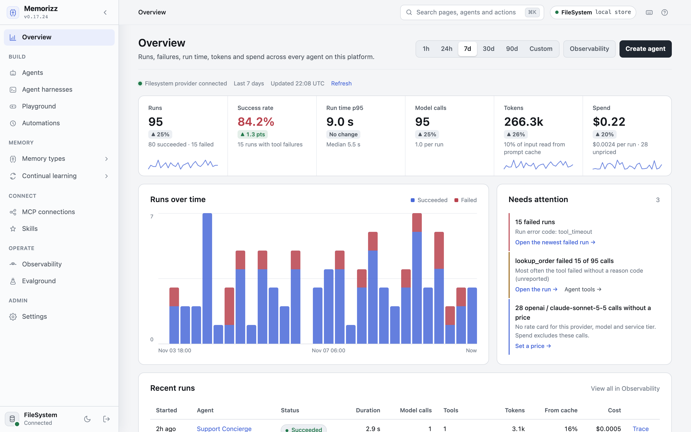
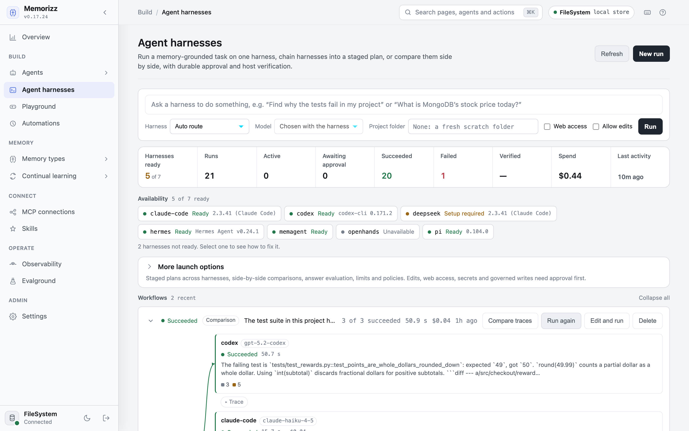

# MemoRizz local UI

A FastAPI + Jinja console for MemoRizz: agents and their playground, every
memory type, traces and usage, continual learning, automations, MCP
connections, Evalground and agent harnesses.

```bash
pip install "memorizz[ui]"
memorizz ui            # http://127.0.0.1:8765
```

<picture>
  <source media="(prefers-color-scheme: dark)" srcset="../../../docs/assets/screenshots/dashboard-dark.png">
  
</picture>

<picture>
  <source media="(prefers-color-scheme: dark)" srcset="../../../docs/assets/screenshots/harnesses-dark.png">
  
</picture>

The agent dashboard (top) and the harness dashboard (bottom).

Connect to a FileSystem, MongoDB, Oracle or Notion memory provider from the
connect page. The user guide is `docs/getting-started/local-ui.md`; tracing
and the observability pages are covered in `docs/observability-ui.md`.

## Layout

- `app.py` builds the application and registers the routers in `routers/`.
- `templates/` holds the pages; `_ui.html` and the other `_*.html` files are
  shared macros. `static/css/console.css` and `static/js/monitor.js` provide
  the shared monitor layout; page-specific styles live in `static/css/pages/`.
  `static/css/shell.css` loads last and holds the application shell: the
  grouped sidebar, the top bar, the command palette (`initializeCommandPalette`
  in `static/js/app.js`) and the sign-in and connect cards. The theme class is
  set on `<html>` before the first paint by the inline script in `base.html`.
  The top bar is sticky on desktop: a new element that sticks to the top of
  the page uses `top: var(--sticky-top)` (the bar's height, zero on phones).
  The bar's breadcrumb comes from `active_page` (the `crumb_areas` map in
  `base.html`): a new area needs an entry there. `page_header` no longer
  prints its `section`. Go-to keys are the `GO_TO` table in
  `initializeShortcuts` (`app.js`); the shortcuts sheet also lists a page's
  own keys from its `.fleet-keys` hints.
- `static/js/shell-menus.js` draws the inbox bell (`GET /api/inbox`, built by
  `inbox.py`; add a source there for anything new that waits on a person)
  and the store switcher (`GET /api/local-stores`). Both routes, and the
  bulk agent actions, live in `routers/shell_api.py`.
- `static/js/monitor.js` gives every `MemorizzMonitor.init` table filter
  chips and a Views menu with no extra markup. `MemorizzMonitor.bulk(table,
  {noun, actions})` adds a checkbox column and an action bar to any table
  whose rows carry `data-key`.
- `activity.py` records changes: the middleware in `app.py` calls
  `activity.record` for every non-GET request that succeeds. A new route
  gets a readable line by adding a rule to `_RULES`; one that should not be
  logged (chat, polling, reads sent as POST) goes in `_SKIP`. Never log
  request bodies.
- The operator's name is `localStorage.memorizzApproverId` plus the
  `memorizz_operator` cookie (`shell-menus.js`). An approver input is filled
  when it matches `APPROVER_FIELDS` there.
- `MemorizzDrawer.open`, `MemorizzMonitor.rowMenu` and the automatic
  *Export CSV* live in `monitor.js`; `chat-preview.js` is the playground's
  preview pane. Its frame must never get `allow-same-origin`.
- The Overview's sections carry `data-widget` and `data-widget-label`; a new
  section needs both to appear under *Customize*.
- `static/js/page-dialogs.js` is loaded on every page. Use
  `MemorizzDialogs.confirm`, `.prompt` and `.notify` instead of the browser's
  `confirm()`, `prompt()` and `alert()`, which block the page.
- `*_view.py`, `dashboard.py` and the `*_monitor.py` modules shape store
  records into what a page shows, without extra reads.
- `state.py` holds the connected provider and shared services;
  `security.py` holds authentication, read-only mode and trace redaction.
- `connection.py` connects (from the connect form, `memorizz ui` flags or the
  environment) and describes the connection for the header on every page;
  `embedding_check.py` compares the store's vectors with the configured
  embedder when the UI connects.

## Security

The UI binds to 127.0.0.1 by default. Before exposing it beyond one machine,
set `MEMORIZZ_UI_AUTH_TOKEN` (or `MEMORIZZ_UI_AUTH_ACCOUNTS`). Set
`MEMORIZZ_UI_READ_ONLY=true` (or `memorizz ui --read-only`) to refuse every
change, including harness launches and approvals. The header then shows a
Read-only badge, and `static/js/app.js` turns off POST forms, controls marked
`data-mutates` and destructive buttons, with a tooltip. Mark a new JS-driven
control that changes data with `data-mutates`.
